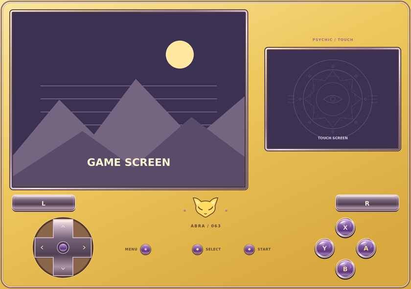

# Delta Duo NDS 皮肤与制作技能

为 iPhone Duo 的 Delta 模拟器整理的 NDS 皮肤制作技能，以及一款凯西风格的水晶金属皮肤示例。技能支持其他配色和主题，不限于此示例。

## 下载

- [下载凯西水晶大主屏皮肤（.deltaskin）](skins/Abra-Crystal-Big-Screen-Duo.deltaskin?raw=true)
- [下载可复用技能包（.skill）](downloads/delta-duo-nds-skin.skill?raw=true)
- [浏览技能源码和说明](delta-duo-nds-skin/SKILL.md)

**`.deltaskin` 是给 Delta 使用的皮肤；`.skill` 是供支持技能导入的工具使用的制作流程，两者用途不同。**

## 皮肤预览



此图中的游戏画面是示意占位图，不包含在皮肤中；本仓库不提供游戏、ROM 或 BIOS。

- 皮肤包含 Duo 内屏、外屏的横竖屏，以及模板中的 splitView 和 cover 素材。
- 展开内屏横屏时，主屏映射框为 536 × 402，副屏为 300 × 225；为了放大主屏，显示区域会跨过折痕，适合完全展开使用。
- 触控屏的超能力图案是**叠加在游戏画面上的半透明前景**，不是游戏背景；触控区域与下屏显示框对齐。
- 已进行归档、资源与坐标静态检查，**尚未在实际设备上验证**。部分沿用官方基准的布局可能出现扩展触控热区重叠警告，实际操作效果需自行确认。

## 安装皮肤

在 iPhone 上下载 `.deltaskin`，打开该文件并选择使用 Delta 导入；然后在 Delta 的 NDS 控制器皮肤设置中选择它。如果系统界面不同，请参考 [Delta 官方皮肤导入说明](https://faq.deltaemulator.com/using-delta/controller-skins)。

## 使用制作技能

下载 `.skill` 文件，并按照所用工具对技能包的导入方式添加；也可以浏览 `delta-duo-nds-skin/` 目录中的技能说明、参考资料和 Python 脚本。示例生成器默认使用凯西灵感的配色，技能本身可用于其他主题和布局。

若在命令行中运行示例生成器或校验器，需要 Python 3、Pillow 和 CairoSVG（CairoSVG 可能还需要系统 Cairo 库）：

```bash
python3 -m pip install Pillow CairoSVG
```

先准备 [Delta 官方 NDS 示例模板](https://media.githubusercontent.com/media/rileytestut/MelonDSDeltaCore/master/MelonDSDeltaCore/Controller%20Skin/Standard.deltaskin)，再运行：

```bash
# 从仓库根目录运行；替换模板路径并使用新的输出目录。
python3 delta-duo-nds-skin/scripts/build_crystal_example.py \
  --template /path/to/Standard.deltaskin --output-dir ./generated \
  --name 'Crystal Example' --identifier com.example.nds.crystal.v1 \
  --layout big-main --overlay psychic

python3 delta-duo-nds-skin/scripts/validate_deltaskin.py ./generated/Crystal-Example.deltaskin
```

校验器的警告需要人工判断；静态检查不等于 Delta 实机运行测试。更多格式细节见 [格式与布局参考](delta-duo-nds-skin/references/format-and-layout.md)。

## 说明

这是非官方粉丝制作示例，与 Delta、任天堂或 Pokémon 官方无关联。Delta 皮肤格式与模板请参考 [Delta 官方文档](https://github.com/altstoreio/Delta-Docs/blob/master/skins/README.md)。
